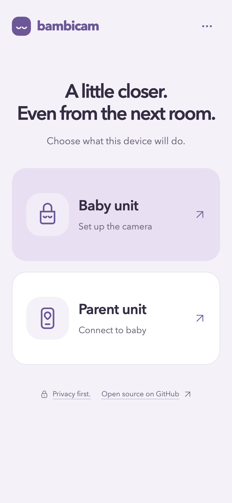
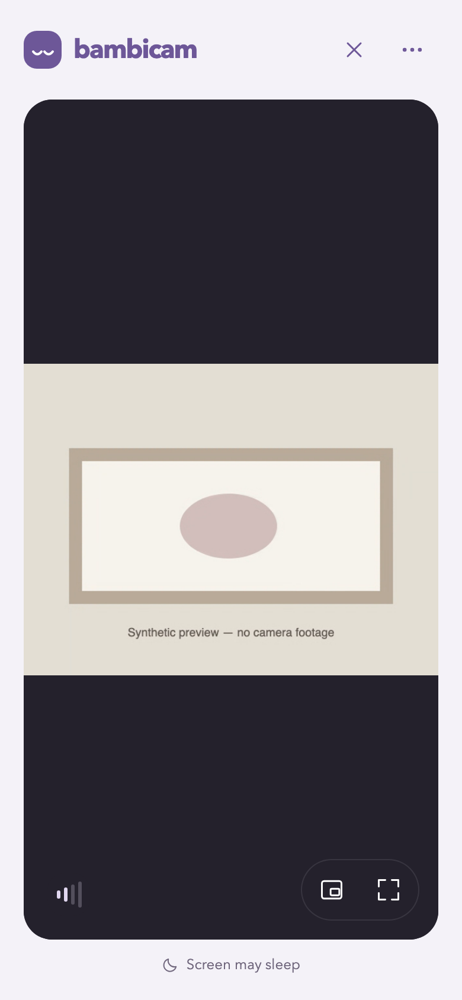

# bambicam

Two devices, one private live view. Leave a phone in the nursery as the **baby
unit** and use another device as the **parent unit**. Audio and video travel
directly between them over encrypted WebRTC. Nothing is recorded.

**[Open bambi.cam](https://bambi.cam)** · [Self-host](docs/SELF-HOSTING.md) ·
[Privacy](docs/PRIVACY.md) · [Contribute](CONTRIBUTING.md)

## Get started

1. Open Bambicam on the nursery phone, choose **Baby unit**, and allow camera
   and microphone access.
2. Scan its QR code with the parent phone, or choose **Parent unit** and scan
   inside the app.
3. Confirm moving video and audible sound. Keep the baby phone powered,
   visible, and unlocked.

The app includes night mode, a sound meter, automatic reconnection, optional
remembered pairing, fullscreen, and picture-in-picture where supported.
Use **Options → Add to Home Screen** for installation instructions.

<p>
  
  
</p>

Screenshots use synthetic video, with no nursery footage or pairing code.

## Know the limits

- This is an early release for one baby unit and one parent. There are no
  cry/motion alerts or recordings.
- Baby capture needs the page visible and the device unlocked. Parent background
  audio, picture-in-picture, and wake lock depend on the browser and OS.
- Start on the same Wi-Fi. Some networks block direct connections; there is no
  TURN media relay fallback.
- Treat the pairing QR/link like a password. **New pairing code** revokes the old
  code; **Forget baby unit** removes a pairing saved on the parent.

The signaling relay forwards encrypted connection messages, not media. It can
see connection metadata and disrupt service. The web host supplies the app code
and remains trusted. See the [security model](docs/SECURITY.md) and
[protocol](docs/PROTOCOL.md) for details; there has been no independent audit.

## Develop locally

Use Node.js 22.12+ and npm:

```sh
npm ci
npm run dev
```

Open `http://localhost:5173`. This starts the web app and relay together. Phones
need trusted HTTPS; see [device testing](CONTRIBUTING.md#testing-on-phones).

```sh
npm run check      # TypeScript, unit tests, production build
npm run test:e2e   # Browser tests; install Chromium as described in CONTRIBUTING.md
```

See [CONTRIBUTING.md](CONTRIBUTING.md) for test setup,
[DEPLOYMENT.md](docs/DEPLOYMENT.md) for Railway hosting, and [PLAN.md](PLAN.md)
for the roadmap.

Licensed under [MIT](LICENSE). Dependency licenses are retained in
[THIRD_PARTY_NOTICES.md](THIRD_PARTY_NOTICES.md).
